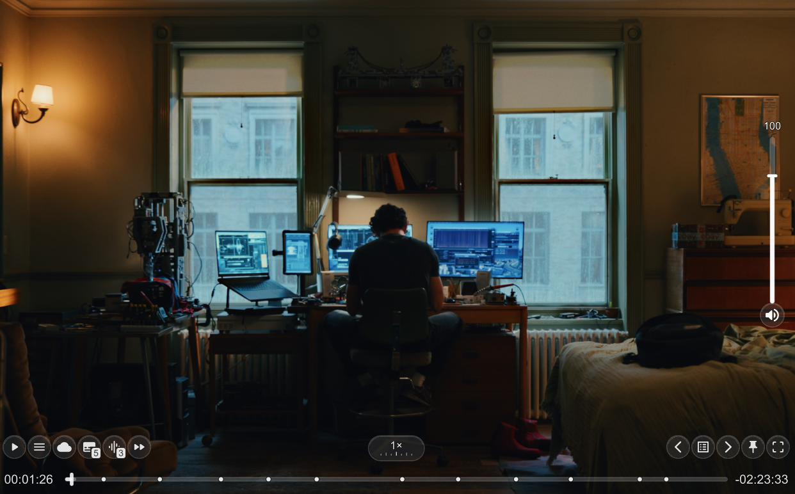
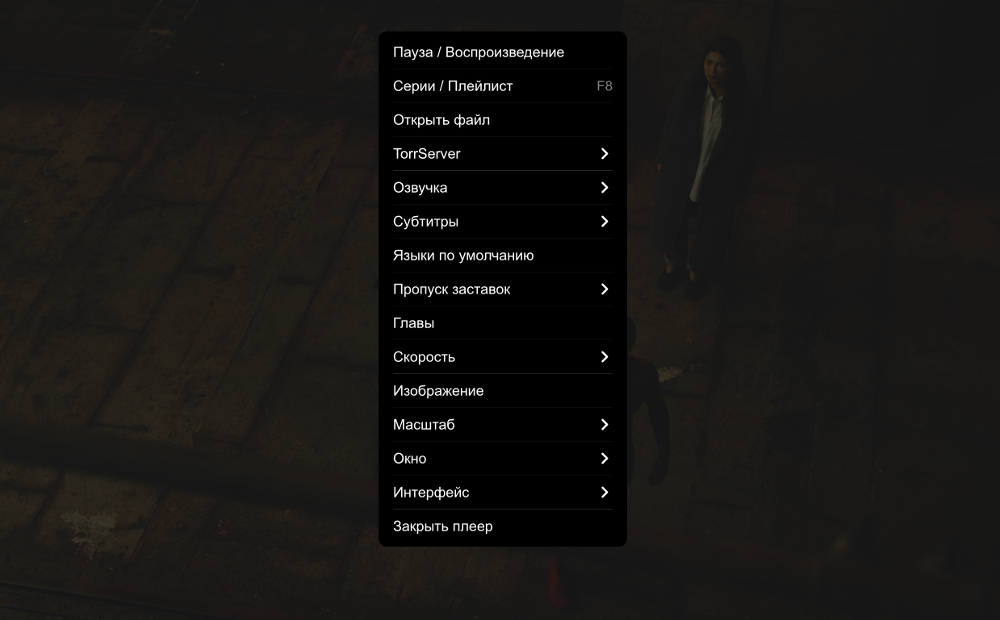
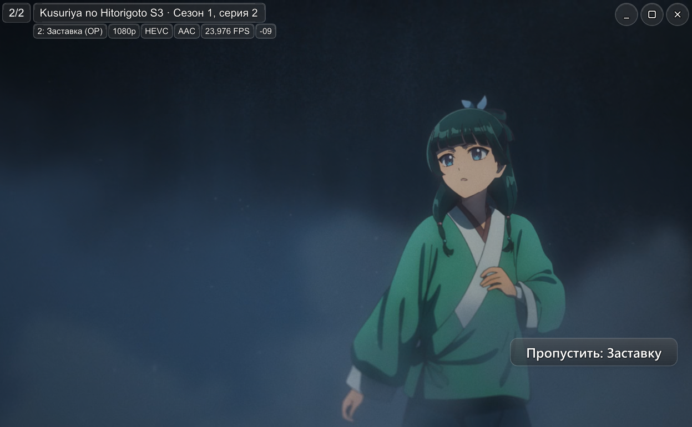
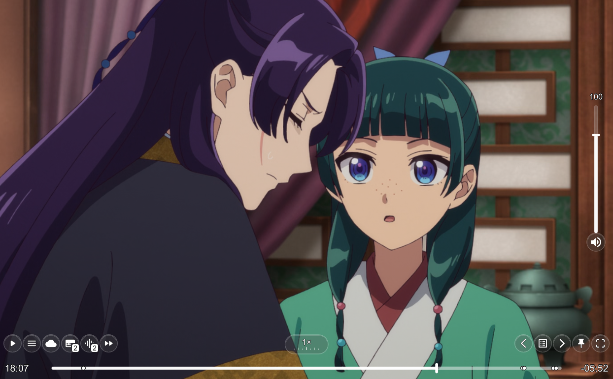
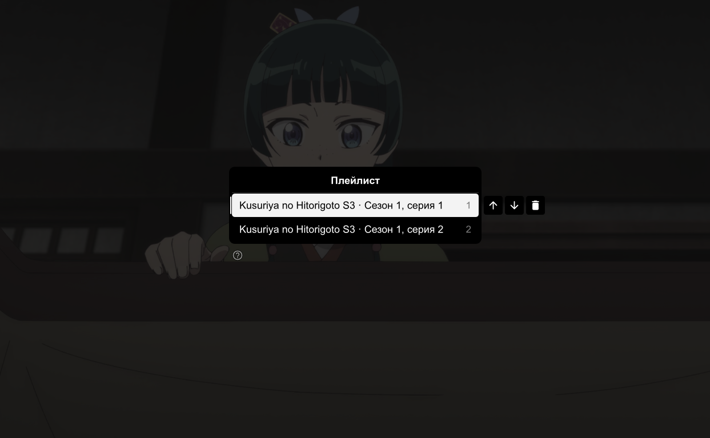

# MPV+ сборка для Windows

Неофициальная сборка [mpv](https://mpv.io/) с настроенным интерфейсом, интеграцией TorrServer и дополнительными функциями для просмотра фильмов, сериалов и аниме. Может использоваться самостоятельно или как внешний плеер в Lampa.

**Текущая версия: 1.0.1 · Windows 10/11 x64**

## Скачать

| Вариант | Назначение |
| --- | --- |
| [Установщик](https://github.com/Notme-SI/MPV/releases/download/v1.0.1/MPV-1.0.1-Setup.exe) | Установка с выбором папки и созданием ярлыков |
| [Портативная версия](https://github.com/Notme-SI/MPV/releases/download/v1.0.1/MPV-1.0.1.zip) | Запуск из распакованной папки без установки |

[Описание выпуска](https://github.com/Notme-SI/MPV/releases/tag/v1.0.1)

## Возможности

- **Интерфейс:** русский и английский языки, выбор оформления, читаемые названия и сведения о медиафайле.
- **TorrServer:** плейлисты, переход между сериями, доступ к добавленным фильмам и сериалам.
- **Пропуск фрагментов:** заставки, рекапы и титры, включая аниме при наличии таймкодов в подключённых базах.
- **Изображение:** автоматическая обрезка чёрных полос с возможностью отключения, настройки яркости, контрастности и других параметров.
- **Дорожки:** предпочтительные языки озвучки и субтитров, поддержка форсированных субтитров, запоминание выбранной озвучки и субтитров сериала, включая отключение субтитров.
- **Сетевое воспроизведение:** восстановление после обрыва, настройка буфера и диагностика потока.
- **Окно:** сохранение размера и режим «Поверх всех окон».

Названия фильмов, сериалов и аниме запрашиваются на языке интерфейса. Выбранная озвучка и субтитры при этом сохраняются. Если перевод отсутствует, каталог может вернуть оригинальное название; если произведение не удалось распознать, используется очищенное имя файла.

## Начало работы

1. Установите плеер либо распакуйте портативную версию целиком.
2. Для работы с TorrServer запустите «Настроить TorrServer» и укажите адрес сервера, который используется в Lampa. При необходимости введите логин и пароль.
3. В настройках Lampa выберите `mpv.exe` из папки установки в качестве внешнего плеера.

Для самостоятельного использования откройте файл через меню плеера или перетащите его в окно. Основное меню вызывается правой кнопкой мыши; `F8` открывает плейлист, `F9` - выбор озвучки.

## Скриншоты

<table>
  <tr>
    <td> Панель воспроизведения</td>
    <td> Меню настроек</td>
  </tr>
  <tr>
    <td> Сведения о медиафайле</td>
    <td> Пропуск заставки</td>
  </tr>
  <tr>
    <td> Панель воспроизведения</td>
    <td> Плейлист</td>
  </tr>
</table>

## Обновление и настройки

«Обновить MPV» проверяет версии компонентов и предлагает установить доступные обновления. Перед установкой закройте плеер. При повторной установке сборки выбирайте прежнюю папку: личные настройки сохраняются. Автоматические резервные копии не создаются.

Установщик по умолчанию использует `%LOCALAPPDATA%\Programs\MPV`. Конфигурация находится в `portable_config` рядом с плеером. Данные TorrServer вводятся пользователем и не входят в публичную сборку.

В меню «Субтитры > Запоминание для сериала» можно отключить память или сбросить выбор. Дорожки сопоставляются по языку, названию и признаку форсированных субтитров, поэтому изменение их порядка не мешает восстановлению. Если однозначного совпадения нет, применяются языки по умолчанию.

В меню «Сеть и буфер» доступны автоматическое восстановление и сведения о запасе видео, скорости чтения и TorrServer. После ошибки HTTP-потока плеер делает до пяти попыток подключения, при ошибке первого открытия - до двух. Для перематываемого файла просмотр продолжается с запасом около двух секунд. Esc отменяет ожидание; ручной переход к другой серии также отменяет повторное подключение. Восстановление начинается после того, как mpv обнаружит ошибку или преждевременный конец потока.

По умолчанию используются настройки буфера mpv. Дополнительные режимы ограничены 256 или 512 МБ и действуют со следующего открытия файла. Буфер сглаживает краткие просадки сети; длительную недоступность сервера он не устраняет.

Наличие переведённых названий и таймкодов зависит от внешних каталогов. Границы фрагментов могут отличаться между раздачами.

## Документация и исходники

- [Управление и настройки](ПРОЧТИ%20МЕНЯ.txt)
- [Сборка ZIP и установщика](BUILD.md)
- [Устройство доработок и обновление компонентов](portable_config/maintenance/README.txt)
- [Состав сборки и источники компонентов](SOURCES.txt)
- [Лицензии](LICENSE)

Репозиторий содержит конфигурацию, скрипты, доработки и исходники установщика. Двоичные компоненты, шрифты и базы данных поставляются в готовых файлах выпуска.

Сборка не является официальным продуктом команды mpv. Сторонние компоненты распространяются на условиях соответствующих лицензий; самостоятельные дополнения сборки - по MIT.
